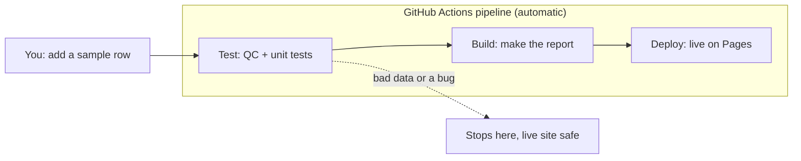

# lab-qc-report

Build a pipeline that checks a qPCR sample sheet, tests the analysis code, builds an HTML QC report with charts, and publishes it to GitHub Pages. It is the same test → build → deploy idea as the learning-reviews lesson, using lab data and Python instead of reviews and Node.

## Goal 
Data analyst adds one row of data, and the pipeline handles everything else. A good row goes all the way to the live report. A bad row, or a code bug, gets stopped at the test step, so the live report is never affected.

## How it works

